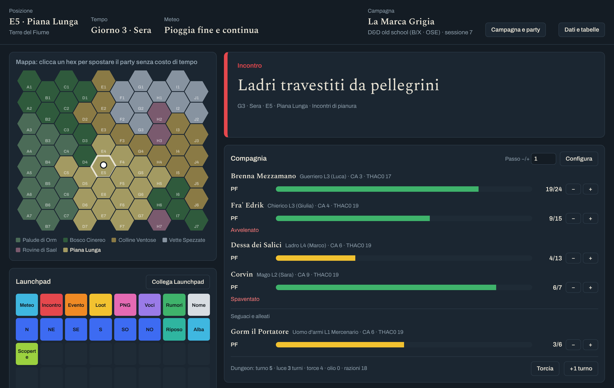
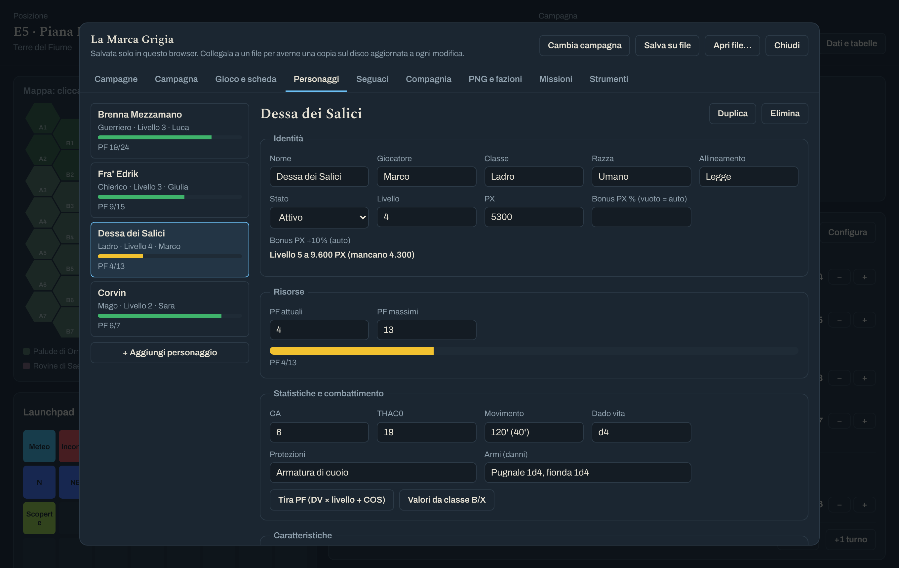
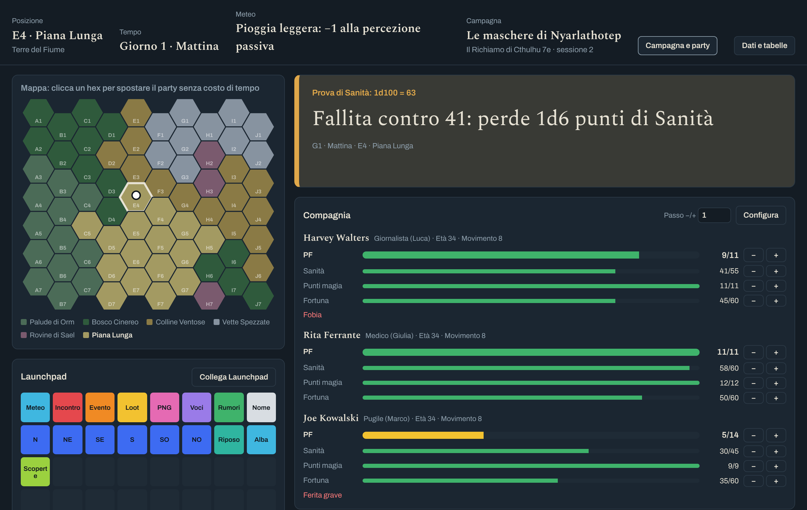

# Enzopad

A game master's table companion for tabletop RPG sessions: hexcrawl map, one-click random tables,
party sheets with health bars and a session log, all in a single offline web page. Works with a
Novation Launchpad (Web MIDI) or with the on-screen pads.

  

> [!NOTE]
> The interface is in Italian. The whole app is one file, `index.html`: no install, no server, no account.

## Contents

- [Features](#features)
- [Screenshots](#screenshots)
- [Requirements](#requirements)
- [Getting started](#getting-started)
- [Campaigns and files](#campaigns-and-files)
- [Supported games](#supported-games)
- [Launchpad](#launchpad)
- [World data and tables](#world-data-and-tables)
- [Where your data lives](#where-your-data-lives)
- [Known limitations](#known-limitations)
- [Contributing](#contributing)
- [License](#license)

## Features

- **Hexcrawl map** with regions and sub-regions; moving the party advances time and checks for encounters.
- **One-click generators**: weather, encounters, events, loot, NPCs, rumours, noises, names.
- **Weighted tables** with cross-references `[[tabella:id]]` and dice `{2d6+1}`, inherited sub-region → region → global.
- **Time and persistent weather**, plus a session log of everything rolled.
- **Campaign manager**: many campaigns side by side, each with its own map, tables, log and party.
- **Character sheets** that adapt to the game: resources with bars (HP, Sanity, Magic points…),
  ability scores with modifiers, stats, saving throws, conditions, powers, gear and coins.
- **Party card** on the main screen with −/+ buttons for every resource.
- **Hirelings, NPCs, factions and quests**.
- **Tools**: free dice roller (`1d20+3`, `4d6k3`, `1d100`, `3d6*5`), party-wide recovery,
  experience split; old-school extras (B/X class tables, dungeon turns and light, reaction, morale).

## Screenshots

  

<em>Character sheet in a D&amp;D old-school (B/X · OSE) campaign.</em>

  

<em>The same table running Call of Cthulhu 7e: four resource bars per investigator.</em>

## Requirements

| | |
|---|---|
| Browser | Chrome or Edge (recommended). Firefox and Safari work without Launchpad and without saving straight to a file. |
| Launchpad (optional) | Launchpad X, Launchpad Mini MK3, Launchpad Pro MK3, over USB |
| Internet | Not needed. Only the web fonts are fetched online; offline the system fonts are used. |

## Getting started

1. Download `index.html` (green **Code** button → **Download ZIP**, or clone the repository).
2. Open it in Chrome or Edge.
3. Press **Campagna e party** to set up the campaign and the characters.
4. Press a pad, or **Collega Launchpad** if one is plugged in.

## Campaigns and files

Campaigns are managed from the **Campagne** tab of the configurator.

- **Automatic saving in the browser**: every change is kept on this computer.
- **Link to a file** (*Collega a un file*, Chrome and Edge): pick a `.campagna.json` file and every change
  is written there too. After the browser restarts, one click on *Riattiva il file* restores access;
  if the file is newer than the browser copy (for example, you played on another computer) the file wins.
- **Open file** (*Apri file…*): resume a campaign from a file. If it is already in the browser, it is updated.
- **Download** (*Scarica*): a copy to keep or move elsewhere; works in every browser.

## Supported games

The **Gioco e scheda** tab starts from a template and lets you change everything:

| Template | Resources with bars | Ability modifier |
|---|---|---|
| D&D old school (B/X · OSE) | HP | 3 = −3 … 18 = +3, plus old-school tools |
| D&D 5e | HP, temporary HP, hit dice | (score − 10) / 2 |
| Call of Cthulhu 7e | HP, Sanity, Magic points, Luck | half and fifth |
| Mörk Borg | HP, Powers, Omens | none |
| Generic | Health | none |

Labels (class, origin, level, experience, alignment) can be renamed or hidden. Character values are stored
by name, so switching template never deletes anything.

## Launchpad

Top row: the eight generators. Second row: travel in the six hex directions, rest and dawn.
The other rows hold the extra tables of the current area. Pads light up in the same colours as on screen.

## World data and tables

**Dati e tabelle** opens the JSON of the open campaign's world: map, legend, regions, sub-regions and tables.
Entries can be plain text or `{"peso":3,"testo":"…"}`; `[[tabella:id]]` rolls another table and `{2d6+1}` rolls dice.

## Where your data lives

Everything stays on your computer: in the browser's storage and, if you link one, in your campaign file.
Nothing is sent anywhere. Clearing the browser data deletes the browser copy, so keep a file for each campaign.

## Known limitations

- Web MIDI and direct file saving need Chrome or Edge.
- After a browser restart the linked file needs one click to be reactivated (browser security rule).
- The interface is Italian only.

## Contributing

See [CONTRIBUTING.md](CONTRIBUTING.md). Changes are listed in [CHANGELOG.md](CHANGELOG.md).

## License

Enzopad is free software released under the [GNU Affero General Public License v3.0](LICENSE).
You can use, study, share and modify it. If you distribute a modified version, or make it available to
others over a network, you must share its source code under the same license.
